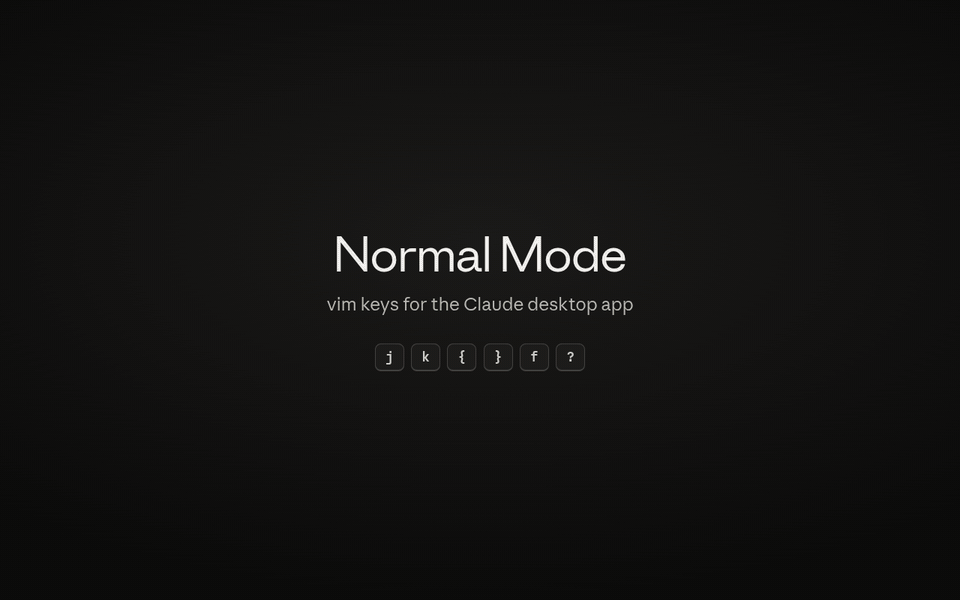

# Normal Mode

Vim-style keys for the Claude desktop app. Scroll with `j` `k`, jump between
your prompts with `{` `}`, click anything with `f`, and switch, fork and move
sessions without touching the mouse.

> **Unofficial.** Not made by or affiliated with Anthropic. It changes how your
> copy of the app behaves, so read the code before you run it, and check
> Anthropic's terms for your situation.

[](docs/demo.mp4)

<sub>45 seconds on a stand-in page with made-up sessions. [Watch the MP4](docs/demo.mp4).</sub>

## Install

### Linux with Nix (full version)

Add the flake and patch the Claude desktop package you already install:

```nix
# flake.nix
inputs.normal-mode.url = "github:danielrousseaug/normal-mode";
```

```nix
# wherever you list packages
(inputs.normal-mode.lib.patch pkgs claude-desktop { })
```

Rebuild and restart Claude. The patch adds one line to the app's startup file
that loads Normal Mode; if Normal Mode is missing, the app starts as usual. It
expects the layout of the official Linux package
(`lib/claude-desktop/resources/app.asar`), which the Nix flakes built from it
share.

To hack on it, load a checkout from your home folder instead, and press `gR`
in the app to reload after edits:

```nix
(inputs.normal-mode.lib.patch pkgs claude-desktop { loadFrom = "code/normal-mode/src"; })
```

### Any platform (quick try)

1. Turn on the app's developer tools by putting `{"allowDevTools": true}` in
   `developer_settings.json` in Claude's settings folder, then restart Claude:
   - Linux: `~/.config/Claude/`
   - macOS: `~/Library/Application Support/Claude/`
   - Windows: `%APPDATA%\Claude\`
2. Read [`src/normal-mode.js`](src/normal-mode.js). You are about to paste it
   into an app that holds your login, so know what it does.
3. Press `Ctrl+Alt+I` (`Cmd+Option+I` on macOS), open the Console, and paste it.

This lasts until the app reloads, and runs without the main-process half:
shortcuts that live in the app's menus (`o`, `x`, `:`) and `Alt+Esc` out of
side panes don't work, and scrolling near the bottom of a reply that is still
streaming can fight the app. Only tested on Linux.

## Keys

Press `?` in the app for the full sheet. In normal mode:

| Keys | Does |
| --- | --- |
| `j` `k` | scroll at one steady speed; a tap moves a little; counts work (`5j`) |
| `d` `u`, `gg` `G` | half page down / up, top / bottom |
| `{` `}` | previous / next prompt you sent; past the last one, the bottom |
| `f` / `F` | click anything / open a session in split view |
| `e` | edit a prompt (rewinds to it and puts the text back in the composer) |
| `gF`, `gm` | fork from a message, open a message's menu |
| `yy`, `yf`, `yl` | copy the reply on screen, a message, the session link |
| `i` `a` | type in the composer; `Esc` or sending a prompt comes back out |
| `Ctrl+C` | stop Claude (copies instead when text is selected) |
| `J` `K`, `g1`…`g9` | next / previous session, go to session N |
| `o` `x` `X` | new, close, reopen session |
| `/` `:` | search sessions, command palette |
| `M` then `j` `k` | move the open session in the sidebar (pinned sessions only) |
| `m{a-z}` `'{a-z}` `''` | mark a session, jump to it, back to the last one |
| `sf` `sr` `sp` `sa` `su` `sg` | fork, rename, pin, archive, unread, open PR |
| `H` `L`, `Ctrl+W` `h` `l` `v` `s` `q` `o` | split views: focus, new, close, expand |
| `tt` `td` `tb` `tf` `tc` `ts` `tv` | terminal, changes, browser, files, side chat, sidebar, transcript view |
| `cm` `co` `ce` `cf` | model, permission mode, effort, fast mode |
| `Alt+Esc` | out of a terminal, editor or side pane |
| `Ctrl+Alt+V` | turn Normal Mode off and on |

Settings (scroll speed, hint letters, staying in normal mode after sending)
are in `CONFIG` at the top of `src/normal-mode.js`.

## How it works

- `src/normal-mode.js` runs in the app's page before the page's own code. It
  sees each key first, and either handles it or lets it through. Its overlay
  (mode indicator, which-key menu, cheat sheet, hints) uses the app's own
  design tokens, so it follows the app's look and light / dark theme.
- `src/main.js` runs in the app's main process. It loads the page script and
  passes its requests to `src/bridge.js`, which turns them into real key
  presses, clicks and wheel scrolls. Most actions press the app's own
  shortcuts, so the app does the actual work.
- `g!` writes the page's structure (no message text) to
  `normal-mode-debug.json` in your temp folder, for bug reports.

## Tests

`test/harness.js` loads `test/mock.html`, a stand-in for the app's Code tab,
in an offscreen Electron window the way the app loads Normal Mode, and drives
it with real key presses. Each scenario prints one line of results.

```bash
nix run nixpkgs#electron -- --no-sandbox test/harness.js
```

Pass scenario names to run some (`tap hold prompts moveSession ...`). Set
`CLAUDE_APP` to an installed Claude package to style the mock with the app's
real stylesheet; `shots` saves screenshots to `$SHOTS`.

`docs/demo/record.js` records the demo above the same way, from
`docs/demo/demo.html`, and writes `docs/demo.mp4` and `docs/demo.gif`:

```bash
CLAUDE_APP=/path/to/claude-desktop nix shell nixpkgs#ffmpeg nixpkgs#electron -c electron --no-sandbox docs/demo/record.js
```

## License

MIT
